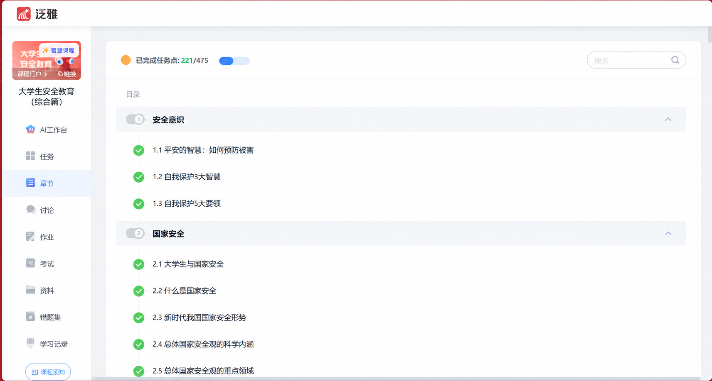
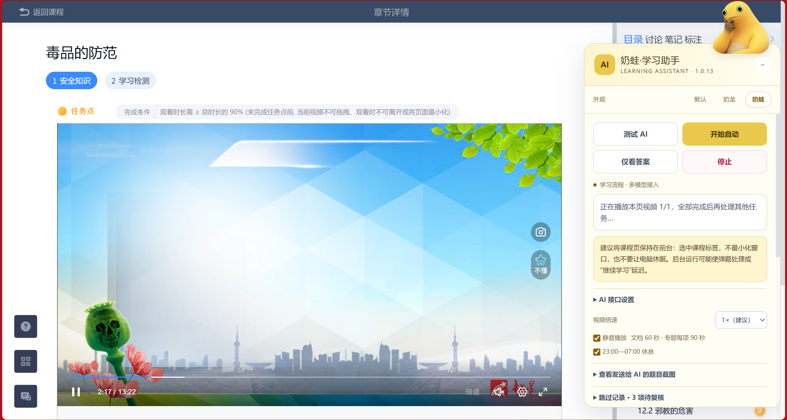
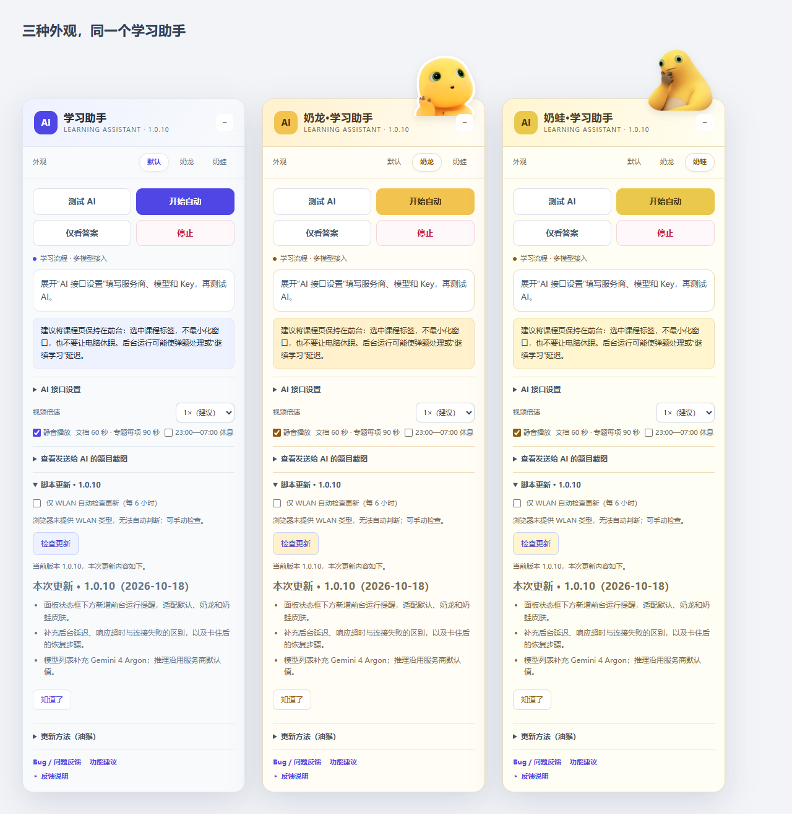

# 超星学习通自动化脚本（支持接入各种主流AI模型API）

## 产品功能

**大学生刷学习通水课的省心帮手。**

如果这个脚本对你有帮助，欢迎给项目点个 **Star**，支持作者继续维护和完善。

把课程里反复点播放、打开文档、切换阅读小节和处理练习题的步骤交给脚本。需要 AI 时，使用你自己配置的模型接口；AI 模式先自动恢复一次再记录跳过；不接入 AI 时直接记录并跳过无法处理的内容，尽量完成其余任务。

> **安装后没有面板？** 请在课程的“章节”目录中，再点开一条具体小节。视频、文档或检测的学习页才是脚本的工作页面。[查看逐步使用引导](#第一次使用从哪里打开学习助手)。

| 功能 | 具体行为 |
| --- | --- |
| 不接入 AI 模式 | 无需 Key 可直接开始；处理视频和阅读，题目记录后跳过，无模型请求；详见下方专节 |
| 手动重试当前页 | 显式点击“开始自动”可重试当前页失败或已跳过的内容，并重置当前章的一次自动恢复预算；历史待复核记录保留 |
| 自动恢复与跳过记录 | AI 模式每章自动测试并重新开始最多一次；无 AI 模式直接记录无法处理内容并继续。面板折叠显示最近跳过项，供最后复核 |
| 后台等待与前台恢复 | 页面响应超时不累计已观察到的后台停留；切回前台先重新核对结果与任务点，再继续等待；视频意外暂停时检查是否可续播，面板仍常显前台运行建议 |
| 视频报错切换线路 | 当前播放器出现已识别的播放错误时，依次试公网1、公网2，每条最多一次、等待约8秒；错误消失且实际播放推进才继续，失败接续恢复/记录跳过 |
| 视频播放 | 同页多个视频逐个播放，倍速可选 1×（建议）至 2×；静音可选并保存 |
| 视频任务点未结算恢复 | 视频实际播完但对应任务点仍未完成时，先等 3 秒，再最多点一次播放器“重播”；等平台确认完成后继续；仍未结算时，AI 模式先测试并重启一次再记录跳过，无 AI 模式直接记录跳过 |
| 整页任务清点 | 依次处理视频、文献/专题和测验；正常完成或已按恢复策略记录跳过后，再进入下一章 |
| 视频中弹题 | 识别单选、多选、判断题，调用 AI 后选择、提交；答对后点继续学习，答错且允许重交时换答案再试 |
| 章节学习检测 | 按实际题目及祖先任务容器识别内联、通用装载器和嵌套 work 检测；检测自己的黄色任务点不挡住答题，失败后也不因外层任务点陷入死等。处理确认窗口及允许次数内的重做 |
| 平台答案反馈 | 保留已确认正确项；无参考答案时对比历史得分复核，不重复提交已失败的整组答案 |
| 图片题 | 支持已适配的题干图片与图片选项；须开启截图并使用视觉模型 |
| 无任务点的拓展资料 | 按资料自身判断是否有任务点；明确无任务点的资料不新增“未完成／待复核”，处理后继续可识别检测；旧记录保留 |
| PDF / Word 阅读 | 识别文档预览，停留 60 秒并滚动文档内部区域，确认可识别的内部滚动条到底后继续本章检测 |
| 专题阅读 | 从“去阅读”打开独立标签，依次点击目录，每项累计前台停留 90 秒；保存进度，读完接续原课程 |
| 未识别内容 | 先等待加载；AI 模式最多测试并重新开始一次，无 AI 模式不测试；无法处理就记录待复核、跳过本项，继续检测或下一节 |
| 弹窗处理 | 适配提交、重做、视频继续学习和星小讲浮窗；可在恢复失败、已记录跳过项后确认未完成任务提示中的“下一节” |
| 夜间休息 | 默认北京时间 23:00–07:00 暂停，可取消；满足运行条件时早晨恢复 |
| 多模型接入 | DeepSeek、小米 MiMo、Kimi、智谱、千问、豆包、硅基流动、OpenAI、Claude、Gemini，也可自定义接口或连接 Codex |
| 模型下拉选择 | 按服务商选择已核实的模型 ID；找不到时选“没有我要的模型，手动填写”，保留已有自定义 ID。目录核对日期与范围见[模型目录](docs/MODELS.md) |
| 按模型适配推理设置 | 只显示当前模型已核实的强度或思考开关，含豆包Seed与千问Omni；按模型发送参数并注明兼容映射；默认沿用模型设置，切换模型不携带旧强度 |
| 脚本更新 | 支持油猴检查更新；面板可手动检查、仅已识别 WLAN 时自动检查，并打开更新页；升级后只展示本次更新内容，提供[详细更新步骤](docs/UPDATES.md) |
| 动态弹题与运行接续 | 后续视频弹题持续检测，已开始的视频等实际结束；同标签同课程显式开启的运行可在刷新后接续，停止或报错取消接续 |
| 卡住恢复 | 区分原题未提交、正在判题和已有反馈；旧提交记录可恢复，未观察到判题启动时最多补点一次 |
| 人工控制 | 仅看答案、停止、截图预览、拖动和折叠面板、保存设置与清除密钥 |
| 可选外观 | 默认蓝紫、奶龙暖黄、奶蛙奶油黄，点击切换并保存；只改变面板外观 |
| 反馈与建议 | 面板直达 GitHub Issue 表单，手动提交脱敏问题或功能需求 |

脚本根据作者自己的实际使用需求编写，并持续完善。遇到暂不支持的场景，或有希望增加的功能，欢迎及时反馈；作者会第一时间跟进，评估后补充相应设置和功能。

## 第一次使用：从哪里打开学习助手？

**安装后，请先进入某一节的学习页面。** 只停在课程首页或章节目录时，看不到面板通常是因为还没进入脚本的工作页面。

先分清这三个页面：

| 你现在看到的内容 | 接下来点哪里 | 是否应当看到面板 |
| --- | --- | --- |
| 多门课程的卡片或列表 | 打开要学习的那门课程，再进入“章节” | 通常不显示 |
| 一门课程的章节目录，列着“1.1 …”“1.2 …”等小节 | 点击一条具体的小节名称；大章标题旁的箭头通常只是展开目录 | 通常不显示 |
| 顶部有“章节详情”，正文是视频、文档或学习检测，旁边可切换小节 | 留在这个页面，等待内容加载，查看右下角“学习助手” | 这是应当检查面板的页面 |

### 第一步：在章节目录中，点开具体的小节

打开课程，点击左侧“章节”。如果看到的是一长列小节名称和完成标记，你现在仍在**目录页**。请点一条具体的小节，例如“1.2 自我保护3大智慧”；不要只点“安全意识”这类大章标题的展开箭头，也不用去找“作业”或“考试”。可以从自己准备继续学习的小节进入。

**图 1：这是章节目录页。点击中间“1.1”“1.2”等具体小节名称，才能进入学习页面。**



### 第二步：确认已经进入章节学习页

点开后，页面应能看到这一节的标题，以及视频、文档或检测内容。示例课程顶部写着“章节详情”，有“安全知识”“学习检测”两个步骤，右边是其他小节的目录。不同课程的名称、排版可能不同，**关键是正文里已经打开某个小节的实际学习内容**。

此时查看右下角是否出现标题含“学习助手”的悬浮面板。默认主题为蓝紫色，奶龙、奶蛙主题为黄色；更换主题不会改变打开方式。面板收起时，点击标题旁的“＋”展开。如果安装脚本时学习页已经打开，请刷新这个学习页，再等内容加载。

地址栏也能辅助辨认：示例目录页的路径含 `/mycourse/stu`，学习页含 `/mycourse/studentstudy`。域名和页面版本可能不同，不需要手动拼地址，也不要复制别人的课程链接；从自己的目录点击进入即可。

**图 2：这是已经进入小节的学习页，右侧可看到“学习助手”面板。**



图 2 使用 1.0.13 的奶蛙主题截图，仅用于辨认页面和面板位置；当前版本的运行模式选项见下方说明。

### 第三步：选择运行方式，再开始

- **先用视频和阅读功能：** 在面板找到“运行模式”，选择“不接入 AI”，直接点击“开始自动”。不需要填写 Key，也不用点“测试 AI”。面板内容显示不全时，在面板内部向下滚动，找到运行模式选项。
- **需要自动答题：** 选择“接入 AI（自动答题）”，展开“AI 接口设置”，填写自己的服务商、模型和 Key，点击“保存设置”→“测试 AI”。测试通过后再点“开始自动”。具体填写方法见[模型配置](docs/PROVIDERS.md)。

开始后，状态框会显示正在处理的内容。请将当前课程标签保持在前台，窗口不要最小化，电脑不要休眠。想中断时点击“停止”；不接入 AI 时，测验和挡住播放的弹题会按规则记录跳过，运行后请查看“跳过记录”，自行补做。

### 已经进入学习页，还是没有面板？

按下面的顺序检查，不必先反复卸载重装：

1. **先核对页面。** 正文里是否已经打开一节视频、文档或检测？如果仍是一长列章节名称，先点开其中一条。
2. **在当前浏览器检查油猴。** 确认脚本已保存、已启用，且装在你正在打开课程的这个浏览器中。另一个浏览器里安装过，不会自动在当前浏览器生效。
3. **检查用户脚本运行许可。** 按油猴和浏览器的提示允许用户脚本运行，并确认扩展可访问当前学习通网站。不同浏览器版本的开关名称可能不同，见[油猴官方说明](https://www.tampermonkey.net/faq.php?locale=zh#Q209)。
4. **刷新具体的学习页。** 停用其他控制同一课程页的脚本，刷新后等视频或文档区域加载，再查看右下角；如果之前拖动过面板，也检查页面其他位置及收起状态。
5. **仍不显示再反馈。** 在[问题反馈](https://github.com/Flyer2333/xuexitong-ai-assistant/issues/new?template=bug_report.yml)中说明浏览器、脚本版本和已完成的检查，附上当前页面及油猴脚本已启用的截图。发图前遮挡姓名、学号、API Key，以及地址中的课程和账号参数。

## 不接入 AI，也能做什么？

**不需要 API Key，也不用先点“测试 AI”。** 安装后在面板的“运行模式”选择 **不接入 AI**，直接点击 **开始自动**。没有保存 Key 的用户默认使用此模式；已配置过接口的用户保留 AI 模式，也可随时切换。切换会停止当前运行，确认后再点“开始自动”；已有模型和 Key 会保留。

| 内容 | 不接入 AI 时的行为 |
| --- | --- |
| 视频 | 逐个播放可识别的视频，保留倍速、静音、播放报错切线、播完后等待任务点结算和一次重播恢复 |
| PDF / Word 等文献 | 打开已适配的预览，停留 60 秒后关闭并继续；只能处理能识别的文件入口和预览 |
| 专题阅读 | 按已适配目录逐项打开，每项累计前台、有焦点的 90 秒；切走或夜间休息时暂停 |
| 章节学习检测 | 不选择答案、不提交、不重做；记录待复核后，继续本章剩余内容或下一节。已有全对成绩页可以继续 |
| 视频内弹题 | 已有可用的“继续学习”按钮时点击继续；仍需作答且挡住播放时，记录并跳过受阻视频，尝试处理其他视频、阅读和后续章节 |
| 未识别或处理失败的内容 | 记录后尝试继续，不因缺少 AI 配置重复测试接口；无可用导航时提示手动接手 |
| 其他设置 | 保留夜间休息、停止、主题、跳过记录、干扰窗口关闭和脚本更新入口；“测试 AI”“仅看答案”在此模式禁用 |

此模式不发送模型请求，也不生成题目截图供模型分析。课程本身、文档加载和手动/自动检查脚本更新仍可能联网，因此它不是离线模式。**跳过不等于完成：被跳过的测验、弹题受阻的视频及未结算任务点仍可能是未完成状态。** 运行结束后请查看“跳过记录”，自行补做。平台没有提供可用的下一步、强制回看、验证码和账号异常等情况仍需手动处理，不能保证整门课程全部完成。

需要自动作答时，将运行模式改为 **接入 AI（自动答题）**，配置或核对接口，保存并测试后再开始。

## 使用前先了解这些限制

- **适配范围：** 当前主要处理已识别的学习通课程页、视频单选/多选/判断题、章节检测、文档预览及专题目录阅读。填空、简答、拖拽和任意外链阅读页不在通用支持范围内，网页改版也可能影响识别。
- **仅自动答题需要 AI：** API Key、模型权限和余额由使用者提供，测试及额外复核可能计费。图片题和特殊字体需要开启截图，并使用支持图片输入的模型。
- **答案不能保证正确：** 模型置信度低于 0.8 或返回无法辨认时，自动模式会随机填写并标注。重做受平台次数限制，新候选不代表正确；连接失败或无效响应不会随机提交。
- **阅读有实际运行条件：** 专题每项只累计前台、有焦点的 90 秒，切走或夜间休息时暂停。普通文档停留 60 秒与专题计时是两种流程，目录变黄、计时结束或滚到底均不保证平台记为完成。
- **不能保证无人值守：** 页面、电脑和网络需要保持可用。账号权限、验证码、监考、平台强制回看及未知弹窗可能需要手动处理；脚本不伪造成绩或平台阅读时长。



用于学习通课程页面的浏览器用户脚本，支持视频播放、文献预览和 AI 辅助答题。可接入国内外多家 AI 服务，也可以连接电脑上的 Codex。不接入 AI 可直接处理视频和阅读；自动答题需配置自己的 API Key 或 Codex 连接码。当前版本：**1.0.15**。

[下载 ZIP](https://github.com/Flyer2333/xuexitong-ai-assistant/archive/refs/heads/main.zip) · [直接安装（Raw，可选）](https://raw.githubusercontent.com/Flyer2333/xuexitong-ai-assistant/main/dist/xuexitong-ai-assistant.user.js) · [完整功能说明](docs/FEATURES.md) · [安装教程](docs/INSTALL.md) · [模型配置](docs/PROVIDERS.md) · [问题反馈](https://github.com/Flyer2333/xuexitong-ai-assistant/issues)

第一次使用可先看 **[完整功能说明](docs/FEATURES.md)**，了解按钮怎么用、脚本按什么顺序运行，以及重做、随机填写和暂停的条件。AI 模式下，接口出错、图片加载失败或平台状态不明确时，每章最多测试并重启一次；无 AI 模式不测试，直接记录无法处理内容并继续。

各项 API 协议已通过模拟测试，但尚未逐一验证真实课程和付费模型，不能保证适配所有页面。测试范围见 [验证说明](docs/VALIDATION.md)，代码来源及尚待确认的许可情况见 [来源与许可](NOTICE.md)。

## 快速开始

1. 在 Chrome 或 Edge 中安装 [Tampermonkey](https://www.tampermonkey.net/)（油猴），按浏览器提示允许用户脚本运行。
2. 点击 **[下载 ZIP](https://github.com/Flyer2333/xuexitong-ai-assistant/archive/refs/heads/main.zip)** 并解压，进入 `dist` 文件夹。右键 `xuexitong-ai-assistant.user.js` → **打开方式 → 记事本**，按 `Ctrl+A`、`Ctrl+C` 复制全部代码。
3. 点击油猴图标 → **添加新脚本**，按 `Ctrl+A` 删除默认代码，再按 `Ctrl+V` 粘贴、`Ctrl+S` 保存。确认油猴列表中的脚本版本为 **1.0.15**。
4. 打开自己的学习通课程 → 点击“章节” → **再点开一条具体小节**，进入正文有视频、文档或检测的学习页。停用其他控制同一课程页的脚本，刷新该学习页，查看右下角“学习助手”。只停在章节目录时通常看不到面板，见[逐步使用引导](#第一次使用从哪里打开学习助手)。
5. 只处理视频和阅读：运行模式选 **不接入 AI**，直接点 **开始自动**。需要自动答题：先切换为 **接入 AI（自动答题）**，再展开 **AI 接口设置**，选择服务商和模型，核对 Base URL 并填写自己的 API Key。列表没有所需模型时选择“没有我要的模型，手动填写”，填写控制台给出的完整 ID。推理设置默认即可；需要截图时核对模型图片能力。
6. 接入 AI 的用户点击 **保存设置 → 测试 AI**；不接入 AI 的用户跳过此步。测试会发送一条短请求，可能计费；连接成功后点击 **开始自动**。

也可以点击 **直接安装（Raw，可选）**，在油猴弹出的安装页确认安装。如果一直停在 `tampermonkey.net/script_installation.php`，请改用上面的 ZIP 方法；该中转页不含脚本代码。仓库 ZIP 是源码包，需要解压后复制 `.user.js`，不能当作油猴备份 ZIP 导入。

使用 API 时，只需配置浏览器脚本。想使用电脑上的 Codex，可按 [安装教程](docs/INSTALL.md) 启动连接服务；该方式需要 Node.js 和 Codex CLI。

## 自动恢复与跳过

以下测试与重启步骤适用于接入 AI 的模式；不接入 AI 时不调用连接测试，直接记录无法处理项并继续。

自动运行异常时，当前章节最多自动执行一次“测试 AI → 开始自动”。恢复后仍失败，就记录待复核并跳过无法处理的内容，优先继续可识别的检测和剩余任务，再下一节；遇到已识别的“本章还有任务点未完成”提示，可点击其中的“下一节”。跳过不会修改平台任务点，也不代表该项已完成。手动停止、仅看答案和夜间休息不会触发自动重启；找不到可用导航或平台禁止前进时仍需人工接手。

面板的“跳过记录”显示最近 20 项，按当前课程保留最多 100 条记录，只存在本浏览器。自动“测试 AI”会发出额外短请求，API 模式可能计费。被跳过的黄色任务点和未通过测验，需要最后自行回看；脚本不会把它们涂成绿色。

## 建议将课程页保持在前台

**运行时请选中正在学习的课程标签，保持浏览器窗口可见，不最小化窗口，也不要让电脑休眠。** 面板状态框下方会一直显示这条建议，无需展开设置。

切到其他标签或最小化窗口后，浏览器可能降低后台页面定时器的执行频率。脚本检查弹题、等待判题结果、点击“继续学习”和核对切章状态的动作因此可能延迟；画面里视频还在播放，也不代表这些检查仍在按原来的频率执行。这种情况不一定是 AI 接口或 Codex 断连。浏览器机制可参考 [Chrome 官方计时器说明](https://developer.chrome.com/blog/timer-throttling-in-chrome-88)。

脚本会从页面响应的超时判断中扣除已观察到的后台停留。回到前台时先读取当前判题结果、任务点和导航状态，并留出至少 3 秒重新检查；已有结果时优先处理，不因后台过去了几十秒就直接重启或跳过。意外暂停会触发一次续播检查，周期检查仍保留；弹题未结束、视频已结束、手动停止或夜间休息时不会用这一检查强行播放。页面长时间没有有效反馈时，仍按“每章恢复一次，再记录跳过”的规则处理。

这项调整不延长 AI 接口请求超时，不把后台时间记作专题有效阅读时间，也不改变平台学习时长或任务点。网页完全冻结、电脑休眠或浏览器关闭时，脚本无法执行；未收到可见性事件的后台停留也无法准确扣除。

如果切回课程页发现卡住：

1. 先保持课程标签在前台，查看面板提示和页面当前状态。
2. 视频弹题已经答对、页面还显示“继续学习”时，可手动点击一次，确认视频恢复；题目尚未提交时，先核对页面再操作。
3. 面板已经提示停止或超时的，处理完当前弹窗后点击“开始自动”重新启动，避免连续重复提交或刷新页面。
4. 只有面板明确提示接口失败、连接失败时，才按相应提示检查 API 设置或本地 Codex 服务。使用本地 Codex 时，服务窗口可以最小化，但不要关闭；课程浏览器仍建议保持前台。

专题阅读会打开独立阅读标签，此时应将该阅读标签保持在前台并有焦点，每项才累计有效停留时间；读完后切回原课程页继续。保持前台只是运行建议，无法保证所有课程都能自动完成，也不能代替平台对学习时长和任务完成情况的判定。当前版本没有新增防休眠、强制抢焦点或保证后台持续运行的功能。

## Bug / 问题反馈与功能建议

遇到 Bug、脚本卡住或有新功能想法，欢迎通过 [问题反馈](https://github.com/Flyer2333/xuexitong-ai-assistant/issues/new?template=bug_report.yml) 或 [功能建议](https://github.com/Flyer2333/xuexitong-ai-assistant/issues/new?template=feature_request.yml) 提交。脚本面板底部也有直达入口。脚本根据作者自己的实际使用需求编写，并持续完善。遇到暂不支持的场景，或有希望增加的功能，欢迎及时反馈；作者会第一时间跟进，评估后补充相应设置和功能。处理进度会在 Issue 中更新。

反馈请附上脚本版本、浏览器和脚本管理器版本、复现步骤、实际结果与预期结果；涉及 AI 时说明服务商和模型名称。可以手动附上脱敏截图。**Issue 是公开的，请勿上传 API Key、连接码、Cookie、学号、姓名或完整课程链接。脚本不会自动采集或上传页面、截图、日志。**


## 接口支持

| 接入方式 | 协议 | 使用说明 |
| --- | --- | --- |
| OpenAI | Responses / Chat Completions | 下拉选择模型或手动填写；按型号适配推理参数，JSON 模式按需开启 |
| Claude | Anthropic Messages | API Key、模型 ID、图片 base64 |
| Gemini | 原生 generateContent | API Key 在请求头中发送，不拼在 URL 中 |
| DeepSeek | OpenAI 兼容 | 预设为纯文字；是否支持视觉由实际模型决定 |
| 小米 MiMo | OpenAI 兼容 | 独立预设，使用 api-key 头和 max_completion_tokens |
| Kimi / Moonshot | OpenAI 兼容 | 选择实际具备视觉能力的模型 |
| 智谱 GLM | OpenAI 兼容 | 通用按量接口，Coding 套餐地址需自行核对 |
| 通义千问 / 百炼 | OpenAI 兼容 | 支持模型/区域对应的兼容地址，视觉模型可开启截图 |
| 豆包 / 火山方舟 | OpenAI 兼容 | 使用控制台模型 ID 或推理接入点 ID |
| 硅基流动 | OpenAI 兼容 | 按控制台完整模型 ID 和视觉能力选择 |
| 其他兼容服务或本地模型 | 自定义 | 选择协议、自填 Base URL，HTTPS；HTTP 仅限 localhost |
| 本地 Codex | 可选本机桥接 | 使用自己的 CLI 登录和连接码，无任何预置账号 |

地址示例、官方文档和常见错误见 [模型配置教程](docs/PROVIDERS.md)。聊天网页会员与 API 通常分别计费，请核对自己的 API 余额。

## 学习流程与界面

- 面板标题为“学习助手”，默认蓝紫色；点击“外观”可切换为“奶龙·学习助手”或“奶蛙·学习助手”，两款角色皮肤均以黄色为主，选择会保存。脚本在油猴中的安装名称不变。
- 面板支持拖动和折叠，AI 设置、截图预览与“反馈说明”按需展开。Bug / 问题反馈和功能建议的蓝色链接始终保留。
- 视频倍速 1×（建议）、1.25×、1.5×、1.75×、2×，静音默认开启，两项选择都会保存。关闭静音后若浏览器阻止有声自动播放，会提示手动播放。平台可能限制倍速或要求前台观看。
- 视频中的单选、多选、判断题会依次分析、选择、提交。答对后点击 **继续学习** 恢复视频；答错且原题仍可编辑时，会参考反馈换答案重交。平台要求回看、次数用尽或选项不可用时，不绕过回看或限制；恢复一次仍无法继续就记录跳过。已有判题状态只等待，不重复点击；旧提交记录与当前页面不一致时可恢复作答。
- 章节检测全对后复核本页和本章其他步骤；都完成后才进入下一节。未全对时，按平台允许的次数重做并保留已确认正确项。没有参考答案时，AI 对比历史得分；若重复失败组合，最多额外复核两次，仍重复则采用尚未提交的候选并提示。组合耗尽、次数用尽或无法确认完成时，恢复一次后仍失败便记录待复核，并继续可处理内容。新候选不代表已知正确。
- 章节图片题支持题干配图和纯图片选项。脚本先加载图片，再生成完整截图，不改动原题页面。跨域图片会按允许的方式尝试读取；读取失败时停止。图片更换后旧答案失效，选项重排时按图片来源标识匹配。
- 自动模式收到格式有效的模型答案后，若置信度低于 0.8，或模型表示无法可靠辨认，会随机填写并标注。网络失败、无效 JSON、未知选项不会触发随机提交。文字模式无法识别图片题或特殊字体时，不会盲目提交；恢复后仍失败会记录跳过，可之后改用视觉模型复核。
- 识别 PDF/Word 入口或嵌入文档后，停留 60 秒，滚动文档内部区域并核对是否到底。关闭本次打开的预览后，继续本页剩余文件、专题或检测。无法控制或确认内部滚动到底时，恢复一次后仍失败会记录跳过，继续其他文件或检测。
- 专题阅读支持已识别的“去阅读”入口和目录页：独立标签逐项前台停留 90 秒，刷新后保留进度，全部结束后接续课程。按实际目录识别，不固定书名、目录数量或章节编号。
- 能处理已适配的提交确认、重做确认、未完成任务点提示（已记录跳过时确认下一节），并尝试关闭星小讲浮窗。遇到新的页面样式先恢复一次，再失败记录跳过。
- 默认北京时间 23:00–07:00 休息，暂停操作并取消正在等待的请求。07:00 后恢复需要电脑、页面和网络仍可用；手动停止会取消恢复预约。
- **仅看答案** 不提交。更换 AI 配置会停止当前自动任务，需要测试后重新开始。

请按课程允许的方式使用。脚本不处理验证码或考试监考，不保证模型答案正确，不伪造平台成绩。

视频进度到头不一定等于任务点已结算。仅当媒体确认播放结束、对应视频任务点仍未完成、没有待处理弹题时，脚本先等 3 秒；仍未完成则最多点一次左下角“重播”按钮（圆形箭头），继续等待对应任务点变绿。按钮确实会触发重播，脚本不会刷新整页、拖进度或修改任务点；平台确认完成后会暂停本次恢复触发的播放，再处理剩余任务。自发现未结算起约 23 秒仍未完成、按钮不可用或状态不明时，AI 模式自动测试并重新开始一次；不接入 AI 时直接记录后继续；不会重复点击同一视频的重播按钮。再次等待仍失败则记录待复核，跳过该项继续。停止、夜间休息、切章和媒体更换会阻止旧恢复操作；不会因为一个视频变绿就跳过本页其他视频。

## 项目结构与开发

```text
dist/xuexitong-ai-assistant.user.js  # 直接安装的公开构建产物
src/ai.js                          # 五种传输适配（含可选 Codex）
src/retry.cjs                      # 历史答案比较与重做去重
src/theme.js                       # 通用界面与 AI 设置
src/workflow.js                    # 学习流程、停止和跨域协调
src/player.js                      # 上游衍生视频控制
src/dom.js / video-quiz.js          # 章节题与视频弹题识别
src/capture.js                     # 图片准备、完整截图与换图保护
src/documents.js                   # 文档识别与内部滚动
src/page-tasks.js                  # 整页任务清点、学习步骤与完成标记
src/reading.js                     # 专题目录、前台计时与跨标签接续
src/bridge.mjs                     # 可选本机 Codex 桥接
vendor/                            # 固定版本库及其许可证
docs/                              # 安装、配置、发布、隐私、验证
```

安装脚本不需要构建。修改源码后，用 Node.js 20.11+：

```sh
npm run build
npm test
```

浏览器回归另需 `npm install`、`npx playwright install chromium`，然后运行：

```sh
npm run test:browser
npm run test:images
node tests/verify-distinct-retry.mjs
node tests/verify-video-quiz.mjs
node tests/verify-playback-rate.mjs
npm run test:reading
npm run test:video-recovery
npm run test:video-lines
npm run test:page-tasks
npm run test:late-popup
npm run test:themes
```

浏览器测试优先使用已安装的 Chrome；也可以按 [开发说明](docs/PUBLISH.md) 使用 Playwright Chromium。CI 的默认检查不需要浏览器或任何密钥。

## 更多文档

- [从零安装与故障排查](docs/INSTALL.md)
- [AI 服务商与协议配置](docs/PROVIDERS.md)
- [上传 GitHub、发 Release、升级与开发](docs/PUBLISH.md)
- [权限、费用与数据流](docs/SECURITY.md)
- [验证记录与尚未实测的部分](docs/VALIDATION.md)
- [来源与许可证边界](NOTICE.md)

脚本通过 `@connect *` 支持自定义接口地址，AI 请求只发往保存的 Base URL。题目、选项、启用的截图和必要的历史反馈会发送给所选服务商。项目没有作者服务器、遥测或题库收集接口；Key 保存在油猴存储中，请勿分享存储导出。


## 更新记录

| 更新时间 | 版本 | 更新类型 | 更新内容 |
| --- | --- | --- | --- |
| 2026-10-19 | 1.0.15 | 新增无 AI 模式 | 无需 Key 连续处理视频和阅读；章节题和受阻视频弹题记录后跳过，不调用模型、不随机答题、不重做；可切回 AI 模式并保留配置；补充从章节目录进入学习页的使用引导和不显示面板的排查步骤。 |
| 2026-10-19 | 1.0.14 | 视频报错恢复、模型适配 | 播放报错时依次尝试公网1/公网2并核对实际播放；保留停止、夜间与弹题保护；补充三个托管模型ID，适配豆包Seed与千问Omni推理强度。 |
| 2026-10-19 | 1.0.13 | Bug 修复、手动重试 | 修复多层 iframe 测验失败后资产已跳过、外层任务点仍等待的死等；点击“开始自动”可重新尝试当前页，保留历史待复核记录；复核 10 家模型目录。 |
| 2026-10-19 | 1.0.12 | Bug 修复、模型补充 | 无任务点资料不再误记未完成；修复检测自身黄标阻塞和多文件重试错开前一份；补充三项千问 3.8 型号及 GPT-6 Sol 的 none 推理选项。 |
| 2026-10-18 | 1.0.11 | Bug 修复、自动恢复 | 视频结束后最多一次重播恢复结算，支持同域与跨域；每章先测试 AI 并重启一次，再失败记录后跳过；页面响应等待扣除已观察到的后台停留，切回前台先重查，补充意外暂停续播检查。 |
| 2026-10-18 | 1.0.10 | 新增运行提醒、模型补充 | 面板新增前台运行提醒；补充后台延迟、超时与连接失败的区别和恢复步骤；模型列表新增 Gemini 4 Argon。 |
| 2026-10-18 | 1.0.9 | 新增更新入口、模型补充 | 接入油猴更新，新增仅 WLAN 自动检查、手动检查与更新页入口，升级后只展示本次更新内容；补充智谱 GLM-5.3 Flash / FlashX 及对应推理设置。 |
| 2026-10-18 | 1.0.8 | 新增模型选择、参数适配 | 按服务商下拉选择模型，保留手动输入及已有自定义 ID；按具体模型显示推理强度或思考开关，避免跨服务商发送不兼容参数。 |
| 2026-10-18 | 1.0.7 | Bug 修复、运行接续 | 修复后续视频弹题漏识别、任务点变绿后提前切视频和状态提示不准确；同标签同课程刷新后可接续已开启的自动运行，停止或报错取消接续；可下载 ZIP 后手动安装，避免卡在 Raw 安装中转页。 |
| 2026-10-17 | 1.0.6 | 流程改进、Bug 修复 | 同页多个视频逐个播放，文献、专题与测验依次处理；本章各学习步骤完成后才切章。修复嵌套文献重复打开；无法确认完成的任务会暂停。 |
| 2026-10-17 | 1.0.5 | 新增外观、界面改进 | 新增默认、奶龙、奶蛙三款可保存皮肤；标题精简为“学习助手”，奶蛙使用透明图；反馈详情默认折叠。 |
| 2026-10-16 | 1.0.4 | 新增功能、Bug 修复 | 新增专题目录阅读，每项累计前台停留90秒；改进嵌套文档滚动，修复旧提交状态导致空等；允许时可按反馈重答视频弹题。 |
| 2026-10-16 | 1.0.3 | 新增设置、Bug 修复 | 新增静音开关；章节重做避免重复失败答案；修复视频答对后不继续、检测入口延迟与截图等待卡住的问题。 |
| 2026-10-15 | 1.0.2 | 新增反馈入口 | 面板新增 Bug / 问题反馈和功能建议入口，支持按表单提供复现步骤、使用环境与脱敏截图。 |
| 2026-10-15 | 1.0.1 | 新增图片题支持 | 支持章节题干图片和纯图片选项；读取失败、题目变化或停止时取消旧结果。图片题需要截图模式及视觉模型。 |
| 2026-10-15 | 1.0.0 | 初始版本 | 支持视频、文献和 AI 辅助答题；提供国内外模型接口配置、可选 Codex 连接、倍速与夜间休息设置。 |

[查看各版本的详细变化](CHANGELOG.md)
