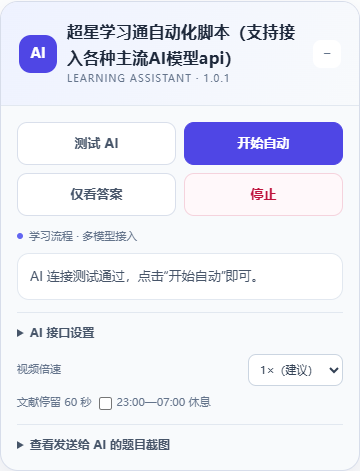

# 超星学习通自动化脚本（支持接入各种主流AI模型api）

通用界面的浏览器用户脚本，支持自配 AI 接口。公开版 **1.0.1** 已合入本机版 0.3.12 的章节图片题补丁，不包含个人 API Key、Codex 连接码、课程记录、日志或角色贴图。

[安装脚本（Raw）](https://raw.githubusercontent.com/Flyer2333/xuexitong-ai-assistant/main/dist/xuexitong-ai-assistant.user.js) · [安装教程](docs/INSTALL.md) · [模型配置](docs/PROVIDERS.md) · [问题反馈](https://github.com/Flyer2333/xuexitong-ai-assistant/issues)

**目前是待真实课程验证的发布候选版。** API 协议已做模拟测试，不代表每家服务商、每个模型均已付费实测。上游授权情况见 [版权与来源](NOTICE.md)，公开发布前请先核对。

## 快速开始

1. Chrome 或 Edge 安装 [Tampermonkey](https://www.tampermonkey.net/)。按扩展要求允许用户脚本运行。
2. 从仓库的 `dist/xuexitong-ai-assistant.user.js` 打开 **Raw** 安装；如果下载后打开不能触发安装，在油猴中“添加新脚本”，用文件全文覆盖示例后保存。不要把 GitHub HTML 页面当作脚本。
3. 停用之前的学习通脚本，刷新课程页。
4. 展开面板的 **AI 接口设置**，选择服务商，填写模型 ID 和自己的 API Key。使用控制台给出的 Base URL，模型是否支持图片以服务商文档为准。
5. 保存，点 **测试 AI**。这会发送一条短请求并按服务商计费；成功后点 **开始自动**。

API 模式无需安装 Node.js、无需启动本地服务、无需登录 Codex。可选 Codex 模式另见 [详细安装教程](docs/INSTALL.md)。



## 接口支持

| 接入方式 | 协议 | 使用说明 |
| --- | --- | --- |
| OpenAI | Responses / Chat Completions | 自填账号可用的模型 ID，可选择是否发送 JSON 模式和推理参数 |
| Claude | Anthropic Messages | API Key、模型 ID、图片 base64 |
| Gemini | 原生 generateContent | API Key 在请求头中发送，不拼在 URL 中 |
| DeepSeek | OpenAI 兼容 | 预设为纯文字；是否支持视觉由实际模型决定 |
| 小米 MiMo | OpenAI 兼容 | 独立预设，使用 api-key 头和 max_completion_tokens |
| Kimi / Moonshot | OpenAI 兼容 | 选择实际具备视觉能力的模型 |
| 智谱 GLM | OpenAI 兼容 | 通用按量接口，Coding 套餐地址需自行核对 |
| 通义千问 / 百炼 | OpenAI 兼容 | 支持模型/区域对应的兼容地址，视觉模型可开启截图 |
| 豆包 / 火山方舟 | OpenAI 兼容 | 使用控制台模型 ID 或推理接入点 ID |
| 硅基流动 | OpenAI 兼容 | 按控制台完整模型 ID 和视觉能力选择 |
| 其他兼容服务或本地模型 | 自定义 | 选择协议、自填 Base URL，HTTPS；HTTP 仅限 localhost |
| 本地 Codex | 可选本机桥接 | 使用自己的 CLI 登录和连接码，无任何预置账号 |

完整示例、官方依据和常见 400/401/429 错误见 [模型配置教程](docs/PROVIDERS.md)。不把网页聊天会员当作 API 余额。

## 学习流程与界面

- 中性蓝紫与石板灰界面，无角色图、花朵和彩虹装饰；可拖动、折叠，设置区可展开。
- 视频倍速 1×（建议）、1.25×、1.5×、1.75×、2×，保存选择；平台可能限制倍速或要求页面保持前台。
- 视频内单选、多选、判断弹题：分析、选中、提交、等待反馈，答对后点击一次 **继续学习**，再恢复当前视频。已答对时优先继续，不重复调用模型。
- 章节检测：全对继续；平台允许重做且次数未用尽时复核；平台明确显示的正确答案可用于后续重做，选项重排时按文字匹配。
- 支持章节题干配图、纯图片选项：先准备图片再完整截图，只在截图克隆中替换，不改原页面。跨域图片有受限读取回退；损坏/读取失败停止，图片变更后旧答案失效。图片选项重排按图片来源标识匹配，不只按占位文字匹配。
- 模型明确返回不确定时沿用原有随机填写策略；网络失败、非法 JSON、未知选项不会转成随机提交。纯文字遇到图片题或特殊字体则暂停，要求启用截图并使用视觉模型。
- PDF/Word 阅读入口或嵌入文档停留 60 秒，尝试滚动可访问区域；关闭本轮打开的预览后先找本节检测，没有再下一节。未知内容优先检测再尝试跳过。平台实际是否记为完成以平台显示为准。
- 提交确认、重做确认、未完成任务点的下一节确认及星小讲浮窗沿用既有适配；未识别结构可能暂停，不能保证覆盖所有页面。
- 默认北京时间 23:00–07:00 休息，暂停动作并取消请求；白天恢复需电脑、页面和网络仍可用。手动停止取消次日恢复。
- **仅看答案** 不提交。更换 AI 配置会停止当前自动任务，需要测试后重新开始。

请按课程允许的方式使用。脚本不处理验证码或考试监考，不保证模型答案正确，不伪造平台成绩。

## 项目结构与开发

```text
dist/xuexitong-ai-assistant.user.js  # 直接安装的公开构建产物
src/ai.js                          # 五种传输适配（含可选 Codex）
src/theme.js                       # 通用界面与 AI 设置
src/workflow.js                    # 学习流程、停止和跨域协调
src/player.js                      # 上游衍生视频控制
src/dom.js / video-quiz.js          # 章节题与视频弹题识别
src/capture.js                     # 图片准备、完整截图与换图保护
src/bridge.mjs                     # 可选本机 Codex 桥接
vendor/                            # 固定版本库及其许可证
docs/                              # 安装、配置、发布、隐私、验证
```

安装脚本不需要构建。修改源码后，用 Node.js 20.11+：

```sh
npm run build
npm test
```

浏览器回归另需 `npm install`、`npx playwright install chromium`，然后运行：

```sh
npm run test:browser
npm run test:images
node tests/verify-video-quiz.mjs
node tests/verify-playback-rate.mjs
```

浏览器测试优先使用已安装的 Chrome；也可以按 [开发说明](docs/PUBLISH.md) 使用 Playwright Chromium。CI 的默认检查不需要浏览器或任何密钥。

## 教程与边界

- [从零安装与故障排查](docs/INSTALL.md)
- [AI 服务商与协议配置](docs/PROVIDERS.md)
- [上传 GitHub、发 Release、升级与开发](docs/PUBLISH.md)
- [权限、费用与数据流](docs/SECURITY.md)
- [验证记录与尚未实测的部分](docs/VALIDATION.md)
- [来源与许可证边界](NOTICE.md)

脚本申请 `@connect *` 是为支持用户自定义 AI 主机；实际调用仅发送到保存的 Base URL。题目、选项、截图和必要的历史反馈可能发给你选择的服务商；没有作者服务器、遥测或题库收集接口。Key 存在油猴存储中，并非加密保险箱。
