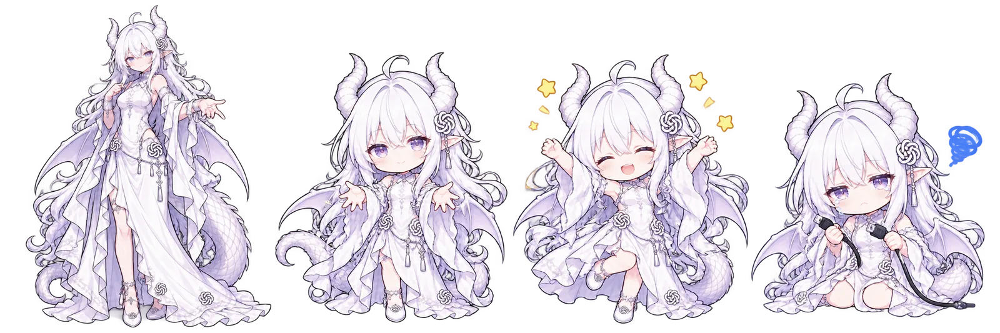
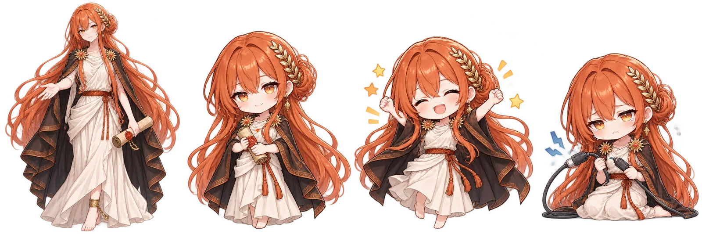
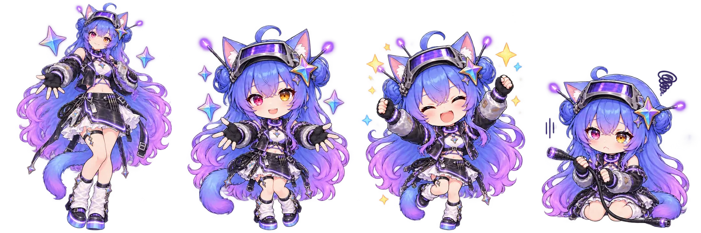
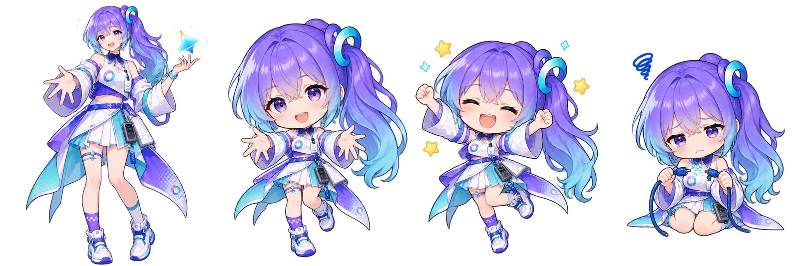
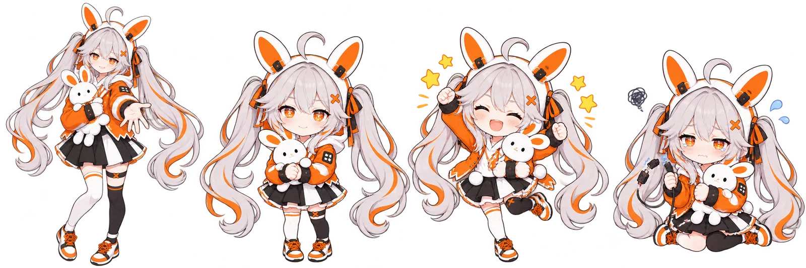

# AI 角色主题

文字接口测试成功后自动显示对应主题。AI 主题的页头图标来自模型品牌；切回默认时，标题恢复“学习助手”、图标恢复“AI”，背景为成熟比例角色、右上角为 Q 版；成功/失败测试分别使用开心与沮丧形象，以无边框的角色动画居中出现，文字置于人物下方。右上角 Q 版使用 160px 图层，向面板内嵌入 72px，裁去素材留白；背景从页头下方开始，头部区域留出空间。默认/AI 开关可切回普通玻璃面板，奶龙、奶蛙按钮可独立切换。未知模型没有参考角色时保持默认，不凭空添加角色。

角色设计依据用户给定的[参考一](https://www.zhihu.com/question/2070559801474375714/answer/2074287390244475384)与[参考二](https://www.zhihu.com/question/2078891449882514701/answer/2079068846850307684)，重新生成适合面板的素材。并非服务商官方角色或授权合作。原角色创作归属见参考来源；生成提示及哈希见 [素材清单](../assets/personas/manifest.json)。

## DeepSeek

## GPT

## Claude

## Gemini

## GLM

## Kimi

## 千问

## 豆包

## MiMo

## 连接状态与隐私

主题以文字接口为准。偶发断连不会马上切回；连续失败并经过观察后退回默认。更换模型或密钥需要重新测试，成功状态最长保留 24 小时。主题只是最近连接状态的提示，不保证持续可用、余额充足或答案正确。图片接口的失败独立展示。

素材内置在脚本，不向角色图床发送模型、密钥或题目。模型图标取自 MIT 的 LobeHub/lobe-icons，固定版本、来源与哈希见 [图标清单](../assets/model-icons/manifest.json)，完整许可见同目录 LICENSE.txt。
