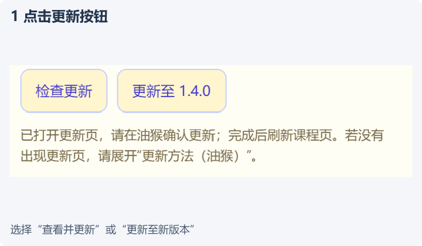
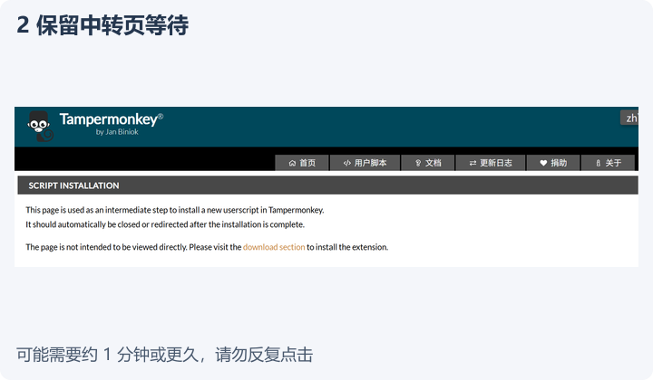
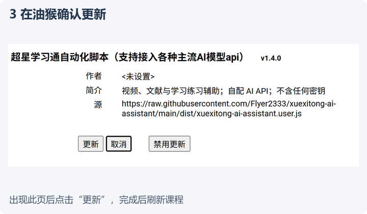

# 安装后的更新方法

从 **1.0.9** 起，脚本内置油猴更新地址和面板更新入口。安装旧版的用户需要先升级一次，才能获得新入口。

## 在油猴更新

1. 点击浏览器工具栏的油猴图标，打开 **管理面板**。
2. 找到本脚本，选择 **检查更新**。也可点击脚本名称进入编辑页，再打开 **设置 → 更新 → 检查用户脚本的更新**。
3. 发现新版本后，按油猴页面提示确认更新。是否后台自动更新、多久检查一次，由油猴设置决定。
4. 刷新课程页，核对“学习助手”面板里的版本号，查看本次更新内容。

如果像旧版一样，“更新 URL”为空，可填入以下地址，点击 **保存**，再检查更新：

```text
https://raw.githubusercontent.com/Flyer2333/xuexitong-ai-assistant/main/dist/xuexitong-ai-assistant.meta.js
```

如果这个地址框是灰色、不能编辑，请直接按本文最后的 ZIP 方法覆盖升级原脚本。新版代码会自带更新地址，无需改浏览器或油猴扩展的权限。

完整脚本下载地址：

```text
https://raw.githubusercontent.com/Flyer2333/xuexitong-ai-assistant/main/dist/xuexitong-ai-assistant.user.js
```

`.meta.js` 只用于检查版本，不要把它复制成脚本运行。脚本名称和 namespace 保持一致，更新时覆盖原脚本；请保留原脚本及其设置，不要先删除后新建。

## 在学习助手面板检查

展开 **脚本更新**，点击 **检查更新**。发现新版本后显示该版本的更新内容和 **更新至版本号** 按钮。点击按钮打开脚本地址，由油猴接管安装；仍需在油猴页面确认，课程页面里的脚本不能静默替换已安装代码。

检查失败只在更新区提示，不停止课程流程，不调用 AI 或消耗模型额度。检查只向固定 GitHub Raw 地址读取小型公开版本文件，不包含 Key、课程链接、截图、答题信息或日志。

## 仅在 WLAN 自动检查

此选项默认关闭。勾选 **仅 WLAN 自动检查更新（每 6 小时）** 后：

- 页面运行且可见、浏览器明确报告 `wifi` 时才自动检查；每 6 小时最多尝试一次，刷新不重置间隔。
- 离线、节省流量、蜂窝网络、以太网或连接类型不明确时，不自动请求。
- 部分桌面浏览器不提供 WLAN 类型，此时会说明“浏览器未提供 WLAN 类型”。请在自己确认可用的网络下手动检查。`effectiveType: 4g` 仅代表网络质量估计，不能证明使用 WLAN。
- 手动点击检查会使用当前网络，不受自动检查的类型限制；离线时仍不发送请求。

**该开关只控制本面板。**油猴自己的后台更新计划独立运行，不受此开关限制。若要求所有后台检查都经本面板判断，应自行调整油猴的自动检查设置。

## 只显示最新更新内容

升级并刷新课程页后，更新区自动展开当前安装版本的本次更新说明。点击 **知道了** 后收起，同一版本不再自动展开，仍可手动查看。这里不拼接历史版本；发现新版本时展示候选版本说明。完整历史保留在 [CHANGELOG](../CHANGELOG.md) 和 README 更新时间表。

## 更新中转页需要等待

点击更新按钮后，油猴可能先显示 Script Installation 中转页，再弹出更新确认窗口。请保留中转页，等待约 1 分钟；网络较慢时可能更久。这个页面暂时不变，不代表已经更新完成，也不需要立即复制粘贴代码。出现油猴确认窗口后点击“更新”，再刷新课程并核对版本号。

| ① 点击更新 | ② 等待油猴加载 | ③ 确认更新 |
| :---: | :---: | :---: |
| [](getting-started/update-step-1.png) | [](getting-started/update-step-2.png) | [](getting-started/update-step-3.png) |

截图版本仅作流程示例，点击可放大。数分钟仍无确认窗口时，再使用下面的备用方式。

## 更新页打不开或卡在中转页

1. 打开 [仓库](https://github.com/Flyer2333/xuexitong-ai-assistant)，点击 **Code → Download ZIP** 并解压。
2. 进入 `dist` 文件夹，用记事本打开 `xuexitong-ai-assistant.user.js`，按 `Ctrl+A`、`Ctrl+C` 复制全部代码。
3. 油猴图标 → 管理面板 → 点击原脚本名称进入编辑器，按 `Ctrl+A`、`Ctrl+V` 替换全部代码，按 `Ctrl+S` 保存。
4. 刷新课程页并核对版本。源码 ZIP 不是油猴备份包，不要用备份导入功能安装。

依据：[油猴更新说明](https://www.tampermonkey.net/documentation.php#meta:updateURL)、[WLAN 类型兼容性](https://developer.mozilla.org/en-US/docs/Web/API/NetworkInformation/type)。

## 顶部新版本提醒

检查到比当前安装版本更高的版本后，面板最上方会显示版本号和更新入口；折叠面板主体时仍可看到横幅。点击“查看并更新”打开油猴更新页，仍由你确认安装。点击 × 会关闭这一个版本的顶部提醒；“稍后提醒”延后 6 小时，之后检查时可以再次显示。关闭或延后都不停止课程、不刷新页面，也不影响“脚本更新”中的手动入口。只有启用且浏览器明确识别为 WLAN 时，面板才会自动检查；不能识别网络类型时请手动检查，油猴自身的更新计划另由油猴管理。
